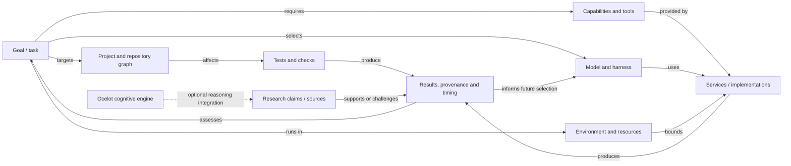

# Ozagia: capability integration analysis

Audited 2026-11-17 against the current checkout and registered worktrees. This is an architectural analysis and proposed direction, not a statement that the proposed internal graph, orchestration or outcome improvements already exist. See [FEATURES.md](../FEATURES.md) for the feature inventory and feature-specific documentation. `main` and active worktrees can change during an audit; the secrets work described below was uncommitted in `ozagia-wt/secrets-core` when inspected.

**Protocol review:** [Ozagia integration analysis against the Ozma Protocol](ozma_protocol_integration_review.md) examines the draft protocol's typed maps, shim, model capability negotiation, fallback and verification boundaries. The internal graph below is a host-side architecture proposal, not an implementation of the Ozma model language or evidence of protocol conformance.

## Thesis

Ozagia's individual capabilities are useful on their own, but their combined value is potentially much larger: each can supply evidence or constraints another needs. A repository graph can locate a change; a goal can define success; environment discovery can select a usable interpreter; the test planner can find relevant checks; failure classification can distinguish a broken environment from broken code; resource admission can limit execution; and an evidence record can tell the next session what actually happened. The resulting workflow gives a model a better-defined problem and a checkable path through it.

This is a way to make the conditions for dependable work less dependent on the operator remembering the right prompts. It may allow a lower-tier model to succeed on a task normally attempted with a larger model, or reduce wall-clock time for fast models that spend much of their time waiting for tools. Neither result follows automatically from having more features: integration overhead, weak retrieval, stale facts, tool-call latency and false certainty can erase the benefit. Those claims need paired end-to-end measurements.

Ocelot remains a separate cognitive engine, including scientific reasoning among its capabilities. Ozagia is the workbench and bridge around available models and Ocelot; the integration described here should not attribute Ocelot's cognitive or executable reasoning capabilities to Ozagia itself.

## What is already connected

The following are concrete connections in the repository, not a claim that every feature is uniformly wired into every harness:

| Connection | Practical effect | Current boundary |
| --- | --- | --- |
| Repository graph → retrieval, symbol navigation, impact and structured edits | Source relationships inform context and editing. | Graph coverage and freshness vary; edit support is language/operation specific. |
| Edits and tests → graph refresh, lint, working set and goals | Changes and checks can inform subsequent context and machine-evaluated goal criteria. | Test selection and goal checks establish only the properties they actually test. |
| Repository review → findings → goals | Review evidence can be converted into scoped work and assessed across sessions. | Findings are candidates for review, not verified defects. |
| Project environments → test selection and failure classification | A missing dependency or wrong interpreter can be identified separately from a task failure. | Project-supplied interpreters require trust; dependency analysis is incomplete. |
| Federation → linked repository search, declared links and cross-repository checks | Independent snapshots can be queried with repository-qualified identity and provenance. | API comparisons and code/IaC observations are narrow; snapshot freshness is frequently unknown. |
| Reference repositories → origin updates and session freshness | Explicitly designated references can be fast-forwarded safely and their freshness surfaced. | Pinned, dirty or divergent checkouts are not moved; updated checkouts still need their graph refreshed. |
| Model catalog → advisory model graph and cached metadata | Task and tool requirements can inform a model comparison. | Advisory matching is not automatic routing or measured proof of competence. |
| Toolchain discovery → daemon, MCP and session context | An agent can see available tools and installation options. | Discovery and previews do not install software. |
| Research records → structured review, synthesis and optional Ocelot reconciliation | Claims, sources, evidence and dissent can be inspected and connected across review work. | Research candidates and recorded relationships do not automatically establish truth. |
| Evaluation → failure classes and component timing | Reports can separate invalid environment failures and distinguish setup/index cost from per-task time. | Timings are bounded by available logs and paired workload evidence. |

The evaluation that motivated the environment work is an example of why linking matters: the Ocelot live-eval report identified checks run under an interpreter missing a dependency, which initially made successful work appear to fail. Correcting the interpreter changed the interpretation of the results. The lesson is about **measurement validity**, not a general proof that Ozagia makes models faster or more accurate. [Evaluation results](results/ocelot_live_eval_2026-11-17.md), [environment design](plans/2026-11-17_env_failures_timing.md).

## The internal graph Ozagia could build

Ozagia has multiple graphs, indexes, registries, session stores and reports today. The opportunity is a **logical internal graph of its own capabilities and the state of work**, connected to project and research graphs through qualified references. This need not mean copying all data into a single database. A federated view can preserve the source of truth and lifecycle of each subsystem, with typed links and queryable provenance.

The diagram is a **target model**. Some edges correspond to current implementations; others are proposed. In particular, the existing repository graph is not yet a comprehensive, authoritative graph of all Ozagia services, runtime permissions, tool capabilities and outcomes.

A minimal useful vocabulary would include:

- **Work:** goal, task, step, claim, finding and acceptance criterion.
- **Subject:** organization/workspace, checkout, snapshot, file, symbol, API operation, infrastructure resource, source, claim and theory.
- **Means:** capability, tool, implementation, model, harness, interpreter, service and dependency.
- **Constraints:** permission, trust, policy, scope, resource budget, privacy and freshness.
- **Evidence:** run, observation, test result, review, artifact, provenance, timing and failure classification.

The important edges are typed and directional: a task *requires* a capability; an implementation *provides* it; a run *used* a particular implementation and version; a finding *concerns* a subject; a test result *assesses* a criterion; an observation *was derived from* a source or snapshot. An inferred relationship should carry its method and confidence; a declared link should remain distinguishable from a verified fact. Failed, unknown, unavailable and stale are first-class states.

**Identity and freshness are prerequisites.** A file key alone is not globally unique; the graph needs organization/repository/checkout/snapshot qualification and stable identity across renames and collisions where possible. Every result needs its source, revision or content hash, observation time and validity scope. A link from one graph to another must not make an old snapshot look current. The current federation's derived aliases can change when membership changes unless a declared member id is used, and its freshness check does not normally certify the working tree; those are concrete gaps to resolve, not details a model should be expected to remember.

## Services that become possible through the links

1. **Task preflight and execution.** A request becomes a goal and bounded task. Resolve target nodes and relevant repositories; check graph/reference freshness; determine available tools and a trusted interpreter; check disk and memory; propose a model and harness using explicit constraints; execute within the authorized scope; run the selected checks; attach results to goal criteria. Today several pieces exist, but a single automatic end-to-end contract across all of them is proposed.
2. **Change and deployment impact.** A changed API operation links to explicitly declared producers, consumers, tests and infrastructure. The service identifies the affected repositories and check plans, marks missing or stale graphs, compares only supported evidence, and records what remains untested. Current federation and static checks provide an initial slice; real contract compatibility, runtime verification and broad code-to-IaC coverage need more work.
3. **Failure diagnosis and recovery.** An environment-classified failure links to the interpreter, imports, manifests, tool readiness and previous test result. The system can suggest a trusted environment or a reviewable installation plan, rerun within policy, and distinguish the repaired environment from a repaired application. Automatic installation and automatic recovery should be explicit capabilities with their own authorization, not inferred from a diagnostic.
4. **Evidence-backed research.** A research question links to sources, claims, assumptions, rival theories, review findings and Ocelot-backed analyses. The system can keep dissent and provenance visible and direct executable or formal checks where supported. A formally valid derivation establishes a consequence of its premises; empirical support for those premises is a separate question. Full automated scientific verification is not established by the present integration.
5. **Model and tool selection.** A task's requirements, context size, privacy constraints and available tools can be compared with the model graph and measured prior results. Start with an explainable recommendation; only automate selection after prospective evaluations show acceptable quality, cost and reliability. The existing model graph is advisory.
6. **Ozagia inspecting itself.** Index Ozagia's own capabilities, CLI/MCP/harness entry points, implementation owners, settings, docs, tests and runtime dependencies. This makes it possible to ask which features are unreachable from a harness, where duplicate concepts disagree, what breaks if a service changes, and which pathways lack evidence. This is a proposed use of existing indexing and adapters, not proof that the current graph already knows every feature or link.

## Design rules for linking

- **Keep facts close to their owner.** Compose views over existing stores first; avoid a second authoritative copy that becomes stale. Link with explicit provenance and versioned schemas.
- **Separate capability from availability and permission.** A tool can exist in code, be installed on a machine, be exposed to a harness, be allowed for a session and actually succeed—these are different facts.
- **Separate plans, actions and evidence.** A proposed test is not a passed test; a declared dependency is not deployed state; a model's answer is not independent verification.
- **Keep unknown visible.** Do not turn unsupported parsers, stale snapshots, a missing interpreter or absent test results into clean results. Preserve dissent, partial coverage and failed refreshes.
- **Preserve boundaries.** Cross-repository discovery is not a permission to edit every repository. Reference sync is explicitly configured; other writes use existing transaction, preview and policy boundaries. Separate user approval and execution from graph queries that only inspect state.
- **Make actions idempotent and observable.** Record operation identity, inputs, revisions, budgets, status and outputs; handle retries, concurrency and partial failure without duplicating or misattributing work.
- **Stay useful for small models.** Deliver concise, task-relevant context with stable handles to drill into, rather than dumping a supergraph into the context window. Track context preparation time and cost as well as token counts.

## Integration gaps and priorities

1. **Capability inventory and contracts.** Define a versioned capability/service schema and registry linking CLI, MCP, daemon and harness surfaces to implementation, inputs, outputs, side effects, permissions, prerequisites, tests and docs. Include explicit coverage and freshness. Begin read-only and derive facts from existing sources; avoid claiming completeness.
2. **End-to-end evidence spine.** Connect goal → task → target snapshot → chosen environment/tool → action → check → result → criterion, using durable IDs and provenance. Make unsuccessful, partial and unavailable steps visible in the same view.
3. **Cross-repository identity and freshness.** Stabilize checkout/repository identities, propagate reference-sync and snapshot freshness to every consuming workflow, and define explicit version-aware links. Treat current exact method/path comparison as identity evidence only.
4. **Service composition.** Add a small number of explicit, inspectable workflows, starting with task preflight and failure diagnosis. Reuse existing gates and transaction policies; do not turn every feature into an autonomous action at once.
5. **Measured model selection.** Join advisory model profiles with actual task requirements and evaluation evidence. Preserve the explicit default; validate any router against that default before enabling it.
6. **Secrets and process boundary.** The separate secrets-core worktree contains an uncommitted broker/session-capture design, and the secure entry UI is a proposal. Integrating secrets with process launch, redaction and a trusted UI requires an end-to-end review before describing it as available on `main`.
7. **Observability of the integration itself.** Show why a tool or model was chosen, which facts and snapshots were used, what was skipped, and how long each part took. An internal graph without trustworthy observability can amplify mistakes as effectively as it amplifies useful work.

## How to test the thesis

Use paired tasks and the same models, repositories, environment and acceptance checks across at least: (a) a basic unscaffolded prompt, (b) a carefully prepared unscaffolded prompt with equivalent context and instructions, (c) individual Ozagia features, and (d) the integrated workflow. Include at least one fast smaller model and one larger model, repeated runs and multiple repositories/tasks. Hold network, caches and approval policy constant or report them explicitly.

Measure task success and independent check validity; wall-clock time including indexing, refresh, model, tool and wait time; total cost; number and latency of calls; operator preparation and interventions; resource incidents; and reproducibility across runs. Report cold and warm/amortized results separately, plus stale/unknown and invalid runs. Compare integrated workflows against the *well-prepared* baseline as well as the basic one. Use ablations to find which links produce benefit and which add overhead. This can distinguish a real improvement in outcomes from merely moving work into setup, or from replacing operator prompting with hidden prompt and retrieval costs.
