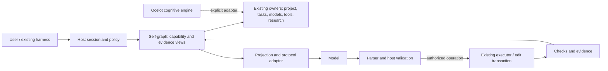

# Self-graph, service unification and model-side API

Status: proposed implementation plan, 2026-11-17. This plan does not assert that the proposed graph, APIs or protocol compliance are already implemented. It builds on [the capability integration analysis](../ozagia_capability_integration_analysis.md), [the protocol review](../ozma_protocol_integration_review.md) and the [locally preserved Ozma protocol research](../research/ozma_protocol/README.md). The imported v5.16 draft is design material; Ozagia owns the next interface and may adopt, adapt or reject each mechanism.

## Objective and success criteria

Make Ozagia's capabilities work as a coherent system: it should know which services exist, what they need, whether they are available and permitted, how they relate to the user's work, and what evidence their execution produces. Give models a compact, versioned way to request and receive the relevant subset, while the host owns state, policy and effects.

A successful first release demonstrates all of the following without requiring a particular model or external service:

1. Given Ozagia itself as a fixture, enumerate registered capabilities and their CLI/MCP/daemon exposure, dependencies, implementation, tests and docs; explain missing, unknown and inconsistent links without claiming the inventory is exhaustive.
2. Given a goal and a changed-file fixture, compose project graph, capability availability, trusted interpreter, resources, affected-test plan and goal criteria into a bounded preflight. Every fact carries source, freshness and an explicit unknown/unsupported state.
3. Project the preflight and a small repository graph into a versioned model-facing map; parse a supported response or fall back to existing plain tools without losing the user's task. A model-emitted edit can produce a preview only after host validation; actual writes continue through `edit/txn.py` and existing authorization.
4. Persist an inspectable, redacted link from goal → task/run → chosen capabilities and inputs → action/check → evidence → criterion, distinguishing a plan, declaration, result, test and proof.
5. Demonstrate this in the native harness and as read-only MCP/CLI operations, with no regressions to existing clients. Show offline fixture and paired performance evidence before suggesting a smaller model can reliably replace a larger one on a defined task class.
6. Build a task profile as a graph throughout the task lifecycle, joining intent, dependencies, decisions, execution, timings, resources, results and evidence. Produce a complete, bounded post-run report, calculate the observed critical path and model alternate inference/resource profiles. Prefetch useful, authorized read-only context while work is in progress, and show whether it reduced time to a verified outcome.

## Current starting points

- The project graph and snapshots live in `core/memory.py`, `core/keys.py`, `core/reingest.py` and `core/federation.py`; cross-repository aliases and working-tree freshness have documented limitations. They are project state, not a comprehensive graph of Ozagia's own services.
- Service-like surfaces already exist in `integrations/mcp/server.py`, `graph_surface.py`, `daemon/protocol.py`, CLI entry points and adapters. `core/status.py`, `core/toolchain.py`, `core/models.py`, `core/model_graph.py`, `core/environments.py` and `core/resources.py` each own part of availability or readiness. Avoid building a second manager for any of them.
- `core/goals.py`, `core/tasks.py`, `core/testing.py`, `core/session.py`, the daemon jobs and the edit transaction layer supply pieces of the evidence and execution path. The bounded runner requires an injected executor and does not call models itself.
- The secret-reference broker and session store have landed in `core/secrets.py`; their existence does not imply that every runtime or GUI resolves secrets securely end to end. Reference values and permissions must never enter projected context or trace payloads.
- `integrations/ozma/context.py` is an existing read-only context provider, not the model-side protocol. The copied historical protocol code under `docs/research/ozma_protocol/upstream/` is reference material, not an installed or self-contained Ozagia runtime.

## Architecture and ownership

The self-graph is a **logical view**, not a new copy of every underlying graph or state store. Owners remain authoritative for their facts. The model API projects a bounded view of the self-graph and project graphs; it does not expose the full graph or transfer authority to the model. Ocelot remains a separate engine connected through explicit interfaces.

### Core contracts

All proposed contracts start at version 1 with canonical JSON as the reference representation; text/protocol encodings are renderers, not separate authorities. Define explicit schemas and fixtures before connecting production surfaces.

**Identity.** Distinguish stable capability IDs (for example `cap:graph.find`), implementation IDs, interface IDs, run IDs, and organization/repository/checkout/snapshot-qualified project keys. An identifier is not a filesystem path or a permission. Define escaping and normalization, collision detection and a migration map; do not silently reinterpret existing local keys or current federation aliases. Scope and content/revision identity must be checked before dereferencing.

**Capability record.** Include ID, schema version, purpose, owner, inputs/outputs and version, side-effect class, exposure (CLI/MCP/daemon/harness), implementation reference, prerequisites, documented limits, authorization requirement, and links to tests/docs. A separately timestamped readiness observation describes installed, configured, reachable, trusted and permitted states. These are independent; unknown is distinct from false. Never execute target-project code to build the inventory.

**Fact and relation.** Every assertion includes source/owner, observed time, subject/version, freshness (`current`, `stale`, `unknown`, `absent`), evidence kind (`declared`, `inferred`, `observed`, `verified`) and relevant scope. Relations carry type, endpoints and evidence. A fresh view cannot be inferred from a fresh parent when one of its inputs is unknown.

**Map schema and instance.** A schema has namespace, version, types, required fields, constraints, sensitivity and a fingerprint over a defined canonical form. An instance has schema reference, scope, snapshot/input identities, provenance, omissions/truncation, created time, size and content hash. Define exactly which fields are hashed and how unknown fields, canonicalization, size limits and cross-version compatibility work. The host controls map scope, retention and invalidation. No protocol fingerprint grants permission.

**Work and evidence.** Reuse existing IDs and stores; add an adapter linking goal, task, selected snapshot and inputs, run, tool/action, check, artifact and criterion. Records reference hashes or redacted metadata, not prompts, secrets or unrestricted logs. `declared`, `pending`, `passed`, `failed`, `unknown`, `invalid` and `not_assessed` must remain distinguishable. Idempotency keys, atomic writes, bounded retention and crash recovery must be specified before mutation is added.

**Model-side request and response.** Requests carry session/workspace scope, requested capabilities, map references or bounded content, budgets and trace ID. Responses carry version, negotiated representation, structured results or errors and source references. An `unsupported` capability or schema triggers a documented fallback; it never becomes an empty successful result. The host, not model text, determines allowed actions. Do not depend on the historical draft's model-generated HMAC for authentication or treat a channel label as a prompt-injection guarantee.

**Timing and dependencies.** A run graph records model calls, prefill/generation when actually available, tool calls, graph/index preparation, queue/resource waits, checks and human gates, with start/end, dependency edges, cache state, provenance and measurement confidence. Do not invent an edge from timestamp order alone or turn missing durations into zero. Its critical path is the longest dependency path through measured or modeled durations; for resource-constrained schedules distinguish the dependency-only lower bound from the simulated schedule. Support cycles/errors, parallel overlap, cancellations, incomplete traces and clock uncertainty explicitly.

**Task profile.** A task has a durable task identity and can have multiple distinct run identities. Its profile is a versioned graph/view over the existing task, goal, session, graph, jobs and evidence stores, rather than a replacement source of truth. It accumulates the initial objective and acceptance criteria; selected scope, revisions, constraints and dependencies; plans and decisions; actual model/tool calls, scheduling and resource observations; changes, tests and verification; errors, fallback and uncertainty; and costs and timing where available. Link every observation to its run and source. Distinguish planned from executed, measured from estimated, and an incomplete or canceled run from a completed run. Record metadata and references only, consistent with existing redaction and secret boundaries.

### Protocol choices for the first release

| Historical concept | Decision for Ozagia v1 | Boundary |
| --- | --- | --- |
| Maps, GRAPH, OUTLINE, INTERACT | Adapt a bounded, typed read-only map and explicit expand/lookup requests. | Canonical JSON first; preserve local keys and snapshot provenance. |
| EDIT, TRANSACTION | Adapt a single structured edit proposal to Ozagia preview. | No new patch fallback; base-hash, parse guards, authorization and atomic transaction stay authoritative. |
| WORK-UNIT, PLAN, TASK, CLAIM | Map selectively to existing goals, task runner, jobs and evidence. | A model assertion is not an executed test or a proof. |
| Capability registry and handshake | Adopt a host-owned version/capability registry and deterministic per-capability negotiation. | Explicit configuration and observed support; no model acknowledgement can elevate access or prove competence. |
| L0/L1/L2 and teaching | Preserve fallback-first intent; implement plain and structured adapters first. | Do not infer native support from model family or promise teaching succeeds. |
| MEMORY, cached references, deltas | Adapt scoped map caching with content hashes and invalidation. | Separate durable records, read ledgers and protocol caches; missing or stale references require re-fetch/fallback. |
| CONTROL/COMMUNICATE, IFC | Preserve origin and trust labels; enforce actual authority in the host. | Labels alone do not isolate a probabilistic model. |
| WIRE/dialects, L4, routing, specialist dispatch | Defer until canonical forms and evaluations establish value. | Historical performance and conformance claims are not acceptance evidence. |
| Ocelot / formal claims | Define an optional adapter after the evidence spine exists. | Identify verifier, premises and result; distinguish recorded, executed and formally checked. |

## Workstreams and milestones

### M0 — baseline, contracts and acceptance fixtures

- Inventory current entry points and ownership from `pyproject.toml`, CLI parsers, MCP tool schemas, daemon operations, settings and adapters. Capture generated inventory with source/version, and separately identify dynamically supplied adapter capabilities; mark unknown coverage.
- Freeze fixtures for a small project, an indexed sibling, a missing dependency, a test failure, stale graph and an untrusted/missing tool. Include Ozagia's own inventory as a fixture, without importing a target project.
- Specify v1 schemas, status vocabulary, qualified IDs, canonical JSON hashing and compatibility policy. Write examples and negative cases before any implementation. Record which historical protocol sections are adopted/adapted/deferred and why.
- **Acceptance:** deterministic fixture output across runs; changed schema and unknown/missing fields produce explicit errors; no network, model calls or target-project imports. Existing code and clients remain unchanged.

### M1 — read-only self-graph and discovery

- Implement a stdlib `core/capabilities.py` registry and a read-only `core/self_graph.py` view. Populate from a small explicit built-in catalogue and adapters over existing MCP/CLI/toolchain/status sources; track origin and scope rather than inferring completeness from source scans.
- Project capability → implementation → surface → dependency → test/doc edges. Join declared tools with runtime readiness and policy as separate observations; represent unavailable or unknown as states. Prevent the inventory operation from invoking mutating actions such as reference sync or starting a daemon.
- Add `ozagia capabilities` and read-only MCP self-graph inspection with paginated/bounded results and scope checks. No auto-install, network or model call.
- **Acceptance:** fixture can locate a capability, its implementations and surfaces; detect a missing documented handler and a handler with no declared mapping; preserve partial/error states. No snapshot rewrite and no imports from target repositories.

### M2 — unified service contracts and evidence spine

- Define thin versioned service adapters around existing repository graph, goal/task, environment, test planning, resource admission, toolchain and status APIs. Return a common result envelope with typed errors, provenance, side-effect class and timeout; keep existing managers and external APIs functional.
- Add a task preflight service that accepts a goal, scope and selected checkout(s); composes freshness, capability readiness, interpreter candidates, resource admission and affected-test plans. Never interpret a plan as an executed test. Reject or mark unknown when selected data cannot be verified.
- Add durable, bounded run/evidence references to existing task and goal records; journal decisions, checks and omissions with redaction and authorized read scope. Reuse locks/atomic writes and explicitly test crashes and partial results. Explain which results are declared, observed or verified.
- **Acceptance:** a fixture traces a failing test through environment selection and a task/goal assessment; missing interpreter or stale graph cannot produce a green goal. Existing feature-specific CLI/MCP results and edit behavior remain compatible.

### M2a — task profile, critical-path analysis and proactive preparation

- Assemble the task profile incrementally from existing task, goal, daemon, session, harness, resource and evaluation events. Preserve source IDs, schema versions and coverage; link work through explicit parent/step/dependency IDs and resource waits. Graph the relationships between objectives, planned and actual actions, snapshots, model/tool choices, checks and evidence as well as the timing DAG. Define lifecycle and partial-report behavior for resumed, failed, canceled and interrupted runs; never fabricate absent events or assume a total event order across processes.
- Provide a **post-run task report** as a bounded, versioned JSON document with a readable rendering. Include outcome against each acceptance criterion; what was requested, planned, executed, changed and verified; selected model/harness/tools/environments and the reasons available for those choices; relevant repository and snapshot freshness; failures, fallback, blocked or skipped work; token, cost, resources and stage timing where measured; critical path, prefetch use/waste and unassessed items. Link to the underlying evidence and clearly mark partial coverage. The report must be derivable again from retained permitted records without including secret values, raw prompts or unrestricted logs.
- Derive a bounded execution/timing DAG from that profile. Record unknown dependency or duration when instrumentation cannot establish it. Expose the observed critical path, per-stage blocking time, independent work, setup and recurring costs, and a replayable trace. Avoid double-counting nested tool/daemon spans and parallel work.
- Add a deterministic what-if model for the **same recorded work** under alternative inference profiles and resource limits. For each model call estimate queue + input tokens / measured prefill rate + output tokens / measured generation rate when those inputs exist; treat cached/uncached input, batching, concurrency, limits and contention separately. Recompute scheduling over the DAG, report assumptions, ranges and confidence, and identify bottlenecks and the critical path after rescheduling. Missing queue, token-rate or dependency evidence yields unknown or a labeled lower bound. A same-model faster allowance is an assumption to validate for each provider/profile, not a universal guarantee of identical outputs or execution paths.
- Generate reviewable optimization opportunities from the profile: work on the critical path that could overlap, repeated reads or unnecessary tool calls, reusable setup/index work, missing prefetch, resource contention and stages where faster inference is unlikely to help. Each recommendation names the supporting observations, estimated benefit or unknown, safety constraints and whether it is a measured observation or a simulation. Compare runs only when task, acceptance criteria, revisions, environment and measurement coverage are compatible; never change scheduling or model selection merely because a profile recommends it.
- Build an opt-in, bounded prefetch planner that uses current task, graph neighborhoods and observed workflow state to prepare likely next **read-only** context while model or independent tool work runs. Initial candidates: relevant caller/callee outlines, affected-test plans, selected environment/tool readiness, already-authorized linked-repository freshness and cached research/source metadata. Prioritize by expected critical-path savings, likelihood of use and resource cost; cap concurrency, time, memory, IO and bytes. Distinguish prefetch from required work and allow cancellation when the task or scope changes.
- Prefetch must use existing access and trust rules; do not start models, import target projects, execute tests, install tools, perform new network fetches, mutate checkouts or perform other side effects merely as speculation. Explicitly configured reference-sync remains its own authorized operation. Cache only appropriately scoped results, preserve source hashes, permissions and freshness, recheck before use, and discard invalidated or unauthorized results. Report errors and unknowns; a cache hit is not proof of current state.
- Surface ready/pending/failed/stale prefetched context automatically at the next relevant turn within the context budget. The model must not need to ask for work that is already ready, and must be able to request missing details. Do not inject irrelevant material just to demonstrate a prefetch hit.
- **Acceptance:** a task fixture produces a linked profile and regenerable report from start to completion, including a failed/partial run and criteria with unknown evidence; resumed or repeated runs remain distinguishable, and secret canaries never appear. A deterministic fake-clock DAG with a branching workload identifies the correct critical path, never sums parallel spans, and predicts a fast-profile run and a resource-constrained run against known schedules. Fixtures demonstrate useful prefetch overlapping model work, fewer blocking calls and no change to task outcome; stale inputs, changed scope, cancellation, errors, budget exhaustion and untrusted paths cannot be served as current. Record unused prefetch, wasted resources and overhead as well as savings.

### M3 — read-only model-side API and map lifecycle

- Implement a model-boundary package, for example `ozagia/model_api/`, with canonical schema/instance validation, hashing and bounded projectors. Select `graph`, `outline`, `capabilities` and `work/evidence` as initial map types; provide task-scoped pagination, source identities, trust labels and truncation markers. Define JSON request/response/error contracts and host policy checks.
- Provide L0-style plain output and a structured v1 representation through adapters around the existing native harness first. Add read-only MCP access without replacing host-native tool protocols. Store cache metadata under the state directory; invalidate on source/snapshot change, session/model switch and relevant compaction, and handle misses without leaking other sessions' data.
- Create a host-owned capability registry and negotiation matrix by model/session/capability/version with explicit configured or observed support, budgets and fallback. Do not claim full historical L1/L2 support. Record negotiation and fallback in redacted trace metadata.
- **Acceptance:** round-trip schema and content-hash fixtures; malformed/oversized/cross-scope/stale references fail closed or return explicit fallback; model swap and cache miss cannot reuse an unauthorized map. L0 and structured clients retrieve equivalent supported facts and omission metadata. No live model required.

### M4 — model output to safe preview and actual checks

- Add one bounded structured `EDIT`-like proposal (one supported Python operation) and one `INTERACT`-like request for more graph context. Parse deterministically with size/depth limits and validate version, node identity, snapshot/base hash, scope and policy.
- Translate valid edit proposals into the existing `edit/txn.py` path. Preview by default and require the same existing authorization as other edits; reject parse errors, changed bases, path escapes and unsupported operations. Do not add a text-patch fallback. No execution of a model-proposed command from parsed content.
- Connect the resulting action and selected checks to M2 evidence. If checks cannot run or the output is only a claim, preserve that status; no model-generated success verdict substitutes for results.
- **Acceptance:** end-to-end deterministic fake-model fixture covers proposal → preview → authorized transaction → refresh → test result → goal assessment, plus stale base, declined/unauthorized write, partial failure, retries and no duplicate action. Compare output to the existing transaction's semantics.

### M5 — linked services, research and Ocelot

- Expand the capability graph and preflight across explicitly selected linked repositories; preserve member authorization, reference sync status and index freshness. Add a plan for API/code/IaC checks that says exactly what was compared and what was not assessed.
- Add a research projection for claims, sources, assumptions and evidence, followed by an optional Ocelot adapter for a narrow documented operation. Record the engine/version, input hashes, output and verifier; keep empirical support and conditional formal derivation distinct. Avoid importing a target project.
- Connect declared service/process/tunnel operations through the existing action layer and its preview/confirmation semantics. Integrate secrets by reference only at established execution boundaries, after end-to-end review; never place resolved secret values in maps, traces or model messages.
- **Acceptance:** two-repository fixture and research fixture show provenance and unknown/stale inputs; unsafe or unavailable services cannot be promoted to allowed; Ocelot absence degrades gracefully. No live cloud or model calls in offline tests.

### M6 — evaluation, rollout and opt-in expansion

- Extend existing retrieval and agent evals with matched arms: plain baseline, well-prompted baseline with equivalent context, existing Ozagia, and Ozagia plus the new map/service path. Hold task, repository, model, tool permissions and independent checks fixed. Test at least one smaller and one larger model, repeated tasks and both cold/warm indexes. Live model drivers require `--live`, `OZAGIA_EVAL_LIVE=1` and a person's approval.
- Measure task success and validity, result reproducibility, wall-clock including indexing/setup/projection/model/tools/wait/check, tool calls, tokens, cost, operator preparation, fallback and parse rates, and stale/unknown coverage. Report per-component and amortized costs using the existing timing framework; do not use a model's self-reported correctness as the acceptance metric.
- Make **time to verified outcome** and **verified tasks per hour** headline measures. Compare predicted versus observed durations, critical-path changes, prefetch hit/use/waste, contention and resource costs. Compare the same task with prefetch disabled and enabled, and model multiple inference allowances with sensitivity ranges; where possible validate predictions against measured runs without implying that a speed profile guarantees the same trajectory.
- Keep the new API opt-in until offline correctness, security checks and fair live evaluation support enabling it. Ship docs and status/doctor visibility for negotiation, fallback, freshness and access. No automatic model routing or compressed wire by default without independent evidence.
- **Acceptance:** published reproducible comparison, clear go/no-go thresholds agreed for the task set before live runs, and no hidden extra costs or missing checks in the reported outcome. If the well-prompted baseline matches or wins, retain the operator-effort/reproducibility findings without overstating model or speed benefits.

## Cross-cutting implementation rules

- Core remains standard-library only; optional parsers, provider clients and language servers are extras and must fail gracefully when missing. Do not import the target project.
- `upstream/` is historical material; inspect and selectively port algorithms or fixtures with the preserved MIT attribution. Do not add the archival code to imports or silently promote the full draft into a normative spec.
- All state writes stay within the selected workspace state directory, apart from explicit caller-authorized edits and configured reference synchronization. Existing transaction and base-hash rules apply. Concurrent calls, cleanup, daemon restart and timeout paths need tests.
- Preserve trust boundaries: classify untrusted content as data; restrict authority through host policy and existing permissions. The protocol cannot guarantee prompt-injection immunity. The graph must not surface secrets or make an unavailable capability appear permitted.
- Add compatibility and migration tests for existing graph keys, MCP tool lists, native/OpenCode harness behavior, task/evidence stores and user config. New schemas have version and bounded extension fields; never silently accept an incompatible schema.
- Cover symlinks, traversal, mixed worktrees, aliases, stale revisions, concurrent updates, partial writes, token limits, malformed responses and cache invalidation. Use real temporary repositories and fake executors/models for integration tests.

## Dependencies and order

M0 → M1 → M2 → M3 → M4 is the critical path for the model API. M2a's trace schema and offline timing model can start after M0; proactive preparation depends on M1/M2 and its model-facing delivery depends on M3. M5 can start its read-only research and linked-repo fixture work after M1, but action integration depends on M2 and model-facing use on M3. M6's offline instrumentation starts with M0; live evaluation comes after M4 and approval. Each milestone should land with its contract, tests, docs and a reviewable integration path; avoid long-lived parallel edits to the same registry, daemon or MCP surface.

## Decisions recorded and remaining

Recorded: logical graph over authoritative stores; stdlib core; canonical JSON first; explicit model capability/fallback; host-controlled authority; existing transactions; no automatic routing or full historical protocol import as runtime.

To resolve during M0 with concrete fixtures: canonical repository identity across moves/remotes and collisions; exact schema canonicalization and fingerprint algorithm; version compatibility and deprecation window; maximum map/context and speculative-work budgets; trace clock and dependency provenance; how inference-profile throughput and queueing are measured; which existing service is the initial registry source of truth; how evidence references survive worktree deletion; and explicit quantitative live-eval thresholds. Treat these as design choices to settle with tests, not a reason to block independent inventory and fixture work.
